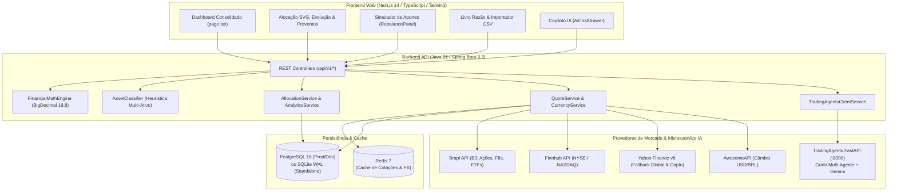

# Invest Portfolio — Plataforma de Consolidação Patrimonial Multi-Ativo & Multi-Moeda

> **Consolidador financeiro full-stack para carteiras globais** (Brasil `B3`, Estados Unidos `NYSE`/`NASDAQ` e `Criptomoedas`), com motor de precisão contábil em `BigDecimal`, cotações e câmbio automatizados com fallback em cascata, simulador inteligente de aportes sem vendas (*No-Sell Rebalancing*) e **Copiloto Financeiro Multi-Agente com IA** ([TradingAgents Homelab](https://github.com/JoseV-001/tradingagents-homelab)).


---

## Visão Geral

Investidores que diversificam seu patrimônio entre corretoras brasileiras (ex.: **Banco Inter / B3**), contas internacionais nos EUA (ex.: **Nomad / NYSE & NASDAQ**) e **exchanges ou carteiras de criptoativos** enfrentam a fragmentação de dados: cada plataforma exibe apenas seu recorte local, em moedas distintas (`BRL` vs `USD`), sem visão consolidada de alocação, risco, dividendos ou evolução patrimonial.

O **Invest Portfolio** resolve esse problema unificando **8 classes de ativos**, **4 mercados** e **2 moedas fiduciárias** em um único ecossistema self-hosted:

### Classes de Ativos, Mercados e Moedas Suportados

| Classe (`AssetClass`) | Mercado (`MarketType`) | Moeda Base (`CurrencyType`) | Exemplos Suportados no Classificador & Carteira |
| :--- | :--- | :--- | :--- |
| **`STOCKS_BR`** (Ações e Units B3) | `B3` | `BRL` | `PETR4`, `VALE3`, `ITUB4`, `WEGE3`, `BBAS3`, `TAEE11`, `SANB11`, `KLBN11` |
| **`FIIS`** (Fundos Imobiliários) | `B3` | `BRL` | `HGLG11`, `MXRF11`, `XPML11`, `KNRI11`, `BTLG11`, `VISC11` |
| **`ETFS_BR`** (ETFs Listados na B3) | `B3` | `BRL` | `IVVB11`, `BOVA11`, `SMAL11`, `HASH11`, `GOLD11`, `NASD11`, `IMAB11`, `LFTS11` |
| **`STOCKS_US`** (Stocks Globais/EUA) | `NYSE` / `NASDAQ` | `USD` | `AAPL`, `MSFT`, `NVDA`, `GOOGL`, `AMZN`, `META`, `BRK.B` |
| **`REITS`** (Real Estate Investment Trusts) | `NYSE` / `NASDAQ` | `USD` | `O` (Realty Income), `STAG`, `VICI`, `PLD`, `AMT`, `EQIX` |
| **`ETFS_US`** (ETFs Internacionais) | `NYSE` / `NASDAQ` | `USD` | `VOO`, `SCHD`, `QQQ`, `VTI`, `VT`, `IAU`, `TFLO`, `SGOV`, `TLT`, `IBIT` |
| **`CRYPTO`** (Criptomoedas) | `CRYPTO` | `USD` | `BTC`, `ETH`, `SOL`, `ADA`, `XRP`, `DOGE`, `DOT`, `AVAX`, `LINK` (e pares `*-USD`) |
| **`CASH`** (Renda Fixa & Reserva de Liquidez) | `B3` / `NYSE` | `BRL` / `USD` | Tesouro Selic, CDBs de Liquidez Diária, Caixa em Dólar / Money Market |

---

## Funcionalidades Reais do Sistema

### 1. Dashboard Consolidado Multi-Moeda (`SummaryCards` & `AssetsTable`)
- **Conversão Cambial Automática (`USD` → `BRL`):** Consolida em tempo real o patrimônio total em Reais (`BRL`), exibindo simultaneamente o valor original em `USD`, a cotação atual do dólar comercial (`USD/BRL`), o custo total investido e o lucro/prejuízo não realizado (`R$` e `%`).
- **Exposição por Jurisdição e Moeda:** Indicadores dedicados da participação percentual e financeira entre **Brasil (`B3 / BRL`)** e **Exterior & Cripto (`NYSE / NASDAQ / CRYPTO em USD`)**.
- **Edição Inline & Criação Automática de Ativos:** Permite ajustar quantidade e preço médio diretamente na tabela ou adicionar novos tickers; caso o ativo ainda não exista no catálogo local, o backend classifica e cadastra o ticker automaticamente via heurísticas determinísticas (`AssetClassifier`).
- **Modo Privacidade (Hide Values) & Modo Demo Offline:** Botão na barra superior para ocultar todos os valores monetários em tela (`R$ •••••`) e snapshot de demonstração resiliente caso o backend esteja offline.

### 2. Alocação Estratégica & Simulador de Rebalanceamento Sem Vendas (`AssetAllocationChart` & `RebalancePanel`)
- **Gráfico Donut SVG Interativo + Barra Empilhada:** Visualização proporcional das 8 classes de ativos com *hover* sincronizado, detalhando valor atual em `BRL`, percentual da carteira e quantidade de ativos por classe.
- **Metas Personalizáveis com Presets de Perfil:** Configuração de metas percentuais (`targetPercentage`) por classe de ativo com validação automática de fechamento em `100%` e 3 perfis prontos: **Equilibrado**, **Conservador** e **Arrojado / Global**.
- **Algoritmo *No-Sell Contribution Simulator* (`AllocationService.simulateRebalance`):** Ao informar o valor de um novo aporte em `R$`, o motor calcula exatamente quanto alocar nas classes **desbalanceadas abaixo da meta** (*underweight*) proporcionalmente ao déficit (`gap`), orientando compras sem gerar eventos tributáveis de venda.

### 3. Evolução Patrimonial Histórica (`EquityEvolutionChart` & `AnalyticsService`)
- **Reconstrução Temporal da Carteira:** Reconstrói até **45 checkpoints históricos** (mensais e na data atual) replayando o livro razão de transações (`BUY`, `SELL`, `SPLIT`, `REVERSE_SPLIT`) contra o histórico de cotações (`quote_history`) e taxas de câmbio (`currency_exchange_rates`).
- **Comparativo Patrimônio de Mercado vs. Capital Investido:** Gráfico de área dupla em SVG com filtros de janela temporal (**6 Meses**, **12 Meses** e **Tudo**), *tooltip* interativo por ponto e cálculo de rentabilidade acumulada no período.

### 4. Inteligência de Proventos & *Yield on Cost* (`DividendsPanel`)
- **Consolidação Multi-Moeda de Renda Passiva:** Processa `DIVIDEND` (Dividendos), `JCP` (Juros sobre Capital Próprio) e `AMORTIZATION` (Amortizações de FIIs/REITs), convertendo proventos recebidos em `USD` pela taxa de câmbio exata do lançamento.
- **Métricas Avançadas de Renda:** Calcula **Total Acumulado**, **Renda nos Últimos 12 Meses (LTM)**, **Média Mensal (12M)**, ***Yield on Cost* (YoC %)** da carteira, gráfico de evolução mensal de proventos e ranking dos **Top Ativos Pagadores**.

### 5. Livro Razão, Importação CSV em Lote & Exportação Fiscal (`TransactionsHistoryPanel`)
- **7 Tipos de Operação (`TransactionType`):** `BUY` (Compra), `SELL` (Venda), `DIVIDEND` (Dividendo), `JCP`, `SPLIT` (Desdobramento), `REVERSE_SPLIT` (Grupamento) e `AMORTIZATION` (Amortização).
- **Motor Matemático Contábil (`FinancialMathEngine`):** Uso estrito de `BigDecimal` com `RoundingMode.HALF_EVEN` (arredondamento bancário), suportando **8 casas decimais para quantidades** (`NUMERIC(19,8)` para frações de stocks nos EUA e criptomoedas), **4 casas para preços unitários** (`NUMERIC(19,4)`) e **6 casas para câmbio** (`NUMERIC(19,6)`).
- **Importação Inteligente em Lote (`POST /api/v1/transactions/batch`):** Modal que aceita colagem direta de planilhas ou upload de arquivos `.csv` / `.txt` (delimitados por `;`, `,` ou `TAB`), normalizando formatos numéricos brasileiros (`1.234,56`) e internacionais (`1234.56`), datas ISO (`YYYY-MM-DD`) ou `DD/MM/YYYY` e sinônimos em português (`COMPRA`, `VENDA`, `DIVIDENDO`, `DESDOBRAMENTO`, `GRUPAMENTO`, `AMORTIZACAO`).
- **Exportação CSV para Imposto de Renda (`GET /api/v1/portfolios/{id}/export/csv`):** Gera relatório completo da custódia atual com **UTF-8 BOM** (compatível nativamente com Microsoft Excel) e resumo do livro de transações.

### 6. Motor de Cotações Multi-Provedor com Fallback em Cascata (`QuoteService` & `CurrencyService`)
- **Cadeia de Resiliência de Preços:**
  1. **Brapi (`BrapiQuoteAdapter`):** Provedor primário para ações, Units, FIIs e ETFs da `B3`, equipado com *rate limiter* determinístico (`ReentrantLock` de `400ms` entre chamadas) e *exponential backoff* automático em caso de `HTTP 429`.
  2. **Finnhub (`FinnhubQuoteAdapter`):** Provedor primário para `Stocks`, `REITs` e `ETFs` listados na `NYSE` e `NASDAQ`.
  3. **Yahoo Finance (`YahooFinanceFallback`):** Fallback universal (`v8/finance/chart`) capaz de resolver ativos da B3 (sufixo `.SA`), ativos americanos e criptomoedas (`BTC-USD`, `ETH-USD`, etc.).
  4. **Última Cotação Persistida (`QuoteHistoryRepository`):** Caso todas as APIs externas estejam indisponíveis ou fora do pregão, utiliza o último fechamento válido salvo no banco de dados.
- **Câmbio Comercial (`AwesomeApiFxAdapter`):** Consulta a paridade `USD-BRL` na AwesomeAPI com cache em Redis e fallback automático para a última taxa persistida em `currency_exchange_rates`.
- **Agendamento no Horário de Pregão:** Job cron (`0 0/15 10-18 * * MON-FRI`, fuso `America/Sao_Paulo`) que atualiza ativos e câmbio a cada 15 minutos durante o pregão, aliado a cache distribuído no **Redis 7**.

### 7. Copiloto Financeiro Multi-Agente com IA (`AiChatDrawer` & `TradingAgentsClientService`)
- **Chat Contextual da Carteira (`POST /api/v1/ai/chat`):** Envia perguntas livres ao microsserviço **TradingAgents**, injetando automaticamente um resumo sanitizado da carteira atual (patrimônio, câmbio `USD/BRL`, participação e P&L de cada ativo em B3, EUA e Cripto) para respostas personalizadas sobre diversificação, risco e alocação.
- **Diagnóstico Profundo por Ativo (`POST /api/v1/ai/analyze/{ticker}`):** Botão **"Analisar com IA"** em cada linha da tabela de ativos que aciona o grafo multi-agente (`Market`, `Fundamentals`, `News`, `Social`, debate `Bull vs. Bear`, `Trader`, `Risk Management` e `Portfolio Manager`) para gerar uma tese completa em Markdown sobre o ticker selecionado.

---

## Arquitetura do Sistema



---

## Stack Tecnológica

| Camada | Tecnologias |
| :--- | :--- |
| **Backend** | Java 21, Spring Boot 3.3.4 (Web, Data JPA, Validation, Cache, Actuator, Scheduling), Flyway, Lombok |
| **Banco de Dados & Cache** | PostgreSQL 16 (perfil padrão `dev`/produção), SQLite 3.46 em modo WAL (perfil opcional `sqlite`), Redis 7 |
| **Frontend** | Next.js 14.2 (App Router), React 18.3, TypeScript 5.6, Tailwind CSS 3.4, Lucide React Icons |
| **Integrações Financeiras** | Brapi (`brapi.dev`), Finnhub (`finnhub.io`), AwesomeAPI (`economia.awesomeapi.com.br`), Yahoo Finance Chart API |
| **Inteligência Artificial** | Microsserviço FastAPI [tradingagents-homelab](https://github.com/JoseV-001/tradingagents-homelab) (LangGraph + Google Gemini) |
| **Infraestrutura & DevOps** | Docker & Docker Compose multi-container, Healthchecks, GitHub Actions CI |

---

## Estrutura do Projeto

```text
invest-portfolio/
├── backend/
│   ├── Dockerfile
│   ├── pom.xml
│   └── src/main/
│       ├── java/com/invest/
│       │   ├── config/          # CorsConfig, Redis/Cache, RestClient e Timezone
│       │   ├── controller/      # Portfolio, Transaction, Quote, Asset e AiAssistant Controllers
│       │   ├── domain/
│       │   │   ├── entity/      # Portfolio, Asset, PortfolioPosition, Transaction, AllocationTarget, QuoteHistory, CurrencyExchangeRate
│       │   │   └── enums/       # AssetClass (8), MarketType (4), CurrencyType (2), TransactionType (7)
│       │   ├── dto/             # Records imutáveis de Request/Response da API REST
│       │   ├── integration/     # BrapiQuoteAdapter, FinnhubQuoteAdapter, YahooFinanceFallback, AwesomeApiFxAdapter
│       │   ├── repository/      # Spring Data JPA Repositories
│       │   └── service/         # FinancialMathEngine, AssetClassifier, QuoteService, CurrencyService, AllocationService, AnalyticsService, TransactionService
│       └── resources/
│           ├── application.yml          # Configuração base, CORS, Actuator e provedores
│           ├── application-dev.yml      # Perfil PostgreSQL + Redis
│           ├── application-sqlite.yml   # Perfil standalone SQLite (sem dependências externas)
│           ├── db/migration/            # Migrations Flyway PostgreSQL (V1 Schema, V2 Seed Demo, V3 Fractional Quantities)
│           └── db/migration-sqlite/     # Migrations Flyway SQLite (V1 Schema, V2 Seed Demo)
├── frontend/
│   ├── Dockerfile
│   ├── package.json
│   └── src/
│       ├── app/                 # App Router (layout.tsx, page.tsx, globals.css)
│       ├── components/          # Navbar, SummaryCards, AssetAllocationChart, EquityEvolutionChart, RebalancePanel, DividendsPanel, TransactionsHistoryPanel, AssetsTable, AiChatDrawer
│       ├── services/            # Cliente HTTP tipado (api.ts) com resolução dinâmica de host
│       └── types/               # Contratos TypeScript espelhados do backend (portfolio.ts)
├── docker-compose.yml           # Orquestração completa: postgres, redis, backend e frontend
└── .env.example                 # Template documentado de variáveis de ambiente
```

---

## Modelo de Dados & Migrations Flyway

O schema relacional é versionado automaticamente pelo **Flyway** na inicialização do backend:

- **`V1__initial_schema.sql`**:
  - `portfolios`: Carteiras do usuário (`id`, `name`, `description`, `base_currency`).
  - `assets`: Catálogo de ativos (`ticker` único, `name`, `asset_class`, `market`, `currency`, `is_active`).
  - `portfolio_positions`: Custódia consolidada por carteira/ativo com `quantity NUMERIC(19,8)` e `average_price NUMERIC(19,4)`.
  - `transactions`: Livro razão imutável de lançamentos (`transaction_type`, `quantity NUMERIC(19,8)`, `unit_price NUMERIC(19,4)`, `fees`, `exchange_rate NUMERIC(19,6)`, `transaction_date`).
  - `allocation_targets`: Metas percentuais por `asset_class` para o simulador de rebalanceamento.
  - `quote_history` & `currency_exchange_rates`: Série histórica de cotações e câmbio `USD/BRL` para fallback offline e gráfico de evolução patrimonial.
- **`V2__seed_initial_transactions.sql`**: Popula uma carteira demonstrativa (`id = 1`) com ativos e transações fictícias multi-mercado para visualização imediata ao subir o projeto.
- **`V3__fix_nomad_fractional_quantities.sql`**: Normaliza posições fracionárias internacionais com precisão de 8 casas decimais e recalcula o preço médio ponderado.

---

## Endpoints da API REST (`/api/v1`)

| Método | Endpoint | Descrição |
| :--- | :--- | :--- |
| `GET` | `/api/v1/portfolios/{id}/summary?refresh=false` | Retorna o resumo consolidado da carteira (`BRL` e `USD`), posições, lucro/prejuízo e alocação por classe (`refresh=true` força atualização externa de preços). |
| `PUT` | `/api/v1/portfolios/{portfolioId}/positions/{assetId}` | Cria ou atualiza diretamente a quantidade e o preço médio de uma posição na carteira. |
| `DELETE` | `/api/v1/portfolios/{portfolioId}/positions/{assetId}` | Remove uma posição e seus lançamentos associados da carteira. |
| `GET` | `/api/v1/portfolios/{id}/allocations` | Lista as metas percentuais configuradas por classe de ativo (`AssetClass`). |
| `PUT` | `/api/v1/portfolios/{id}/allocations` | Atualiza as metas percentuais de alocação por classe de ativo. |
| `GET` | `/api/v1/portfolios/{id}/rebalance?amountBrl=1000` | Simula a distribuição ideal de um novo aporte em `BRL` priorizando as classes abaixo da meta. |
| `GET` | `/api/v1/portfolios/{id}/dividends` | Retorna métricas consolidadas de proventos (`DIVIDEND`, `JCP`, `AMORTIZATION`), *Yield on Cost*, histórico mensal e ranking por ativo. |
| `GET` | `/api/v1/portfolios/{id}/evolution` | Reconstrói a série histórica de evolução patrimonial (valor de mercado vs. custo investido). |
| `GET` | `/api/v1/portfolios/{id}/export/csv` | Exporta relatório CSV (UTF-8 com BOM) das posições consolidadas e histórico de transações. |
| `POST` | `/api/v1/transactions` | Registra uma nova transação (`BUY`, `SELL`, `DIVIDEND`, `JCP`, `SPLIT`, `REVERSE_SPLIT`, `AMORTIZATION`) e recalcula a posição. |
| `POST` | `/api/v1/transactions/batch` | Importa uma lista de transações em lote (com criação automática de tickers inéditos via `AssetClassifier`). |
| `GET` | `/api/v1/transactions/portfolio/{portfolioId}` | Lista todas as transações da carteira ordenadas cronologicamente. |
| `DELETE` | `/api/v1/transactions/{id}` | Exclui uma transação e recalcula integralmente a posição e o preço médio do ativo. |
| `GET` | `/api/v1/assets` / `/api/v1/assets/{ticker}` | Lista todos os ativos cadastrados ou consulta um ticker específico. |
| `GET` | `/api/v1/quotes/{ticker}` | Consulta a cotação atual de um ativo acionando a cadeia `Brapi -> Finnhub -> Yahoo -> DB`. |
| `GET` | `/api/v1/quotes/fx/usd-brl` | Retorna a cotação atual do dólar comercial (`USD/BRL`). |
| `POST` | `/api/v1/ai/chat` | Envia pergunta contextualizada com o snapshot da carteira ao Copiloto IA (`TradingAgents`). |
| `POST` | `/api/v1/ai/analyze/{ticker}` | Executa análise profunda multi-agente para um ativo específico (`B3`, `NYSE/NASDAQ` ou `CRYPTO`). |

---

## Como Executar o Projeto

### Pré-requisitos
- **Docker** e **Docker Compose** (para execução containerizada completa), **ou**
- **JDK 21+**, **Maven 3.9+** e **Node.js 20+** (para execução local em modo desenvolvimento).

### Opção 1: Subindo Tudo com Docker Compose (Recomendado)

1. Clone o repositório e crie seu arquivo `.env` a partir do template `.env.example`:
   ```bash
   git clone https://github.com/JoseV-001/invest-portfolio.git
   cd invest-portfolio
   cp .env.example .env
   ```
2. Preencha suas chaves gratuitas (`BRAPI_TOKEN` e `FINNHUB_API_KEY`) no `.env` (caso deixe em branco, o sistema utilizará automaticamente o fallback do **Yahoo Finance** e o histórico local).
3. Suba os containers:
   ```bash
   docker compose up -d --build
   ```
4. Acesse a aplicação:
   - **Frontend Web:** `http://localhost:3002`
   - **Backend API / Healthcheck:** `http://localhost:8080/actuator/health`

### Opção 2: Execução Local para Desenvolvimento (Sem PostgreSQL/Redis via Perfil `sqlite`)

Caso queira rodar o backend localmente sem precisar subir PostgreSQL ou Redis, utilize o perfil `sqlite`:

```bash
# Terminal 1 — Backend Spring Boot (com banco SQLite embutido em ./data/invest_portfolio.db)
cd backend
mvn spring-boot:run -Dspring-boot.run.profiles=sqlite

# Terminal 2 — Frontend Next.js
cd frontend
npm install
npm run dev
```

---

## Variáveis de Ambiente (`.env.example`)

| Variável | Padrão | Descrição |
| :--- | :--- | :--- |
| `SPRING_PROFILES_ACTIVE` | `dev` | Perfil do Spring Boot (`dev` para PostgreSQL + Redis, `sqlite` para banco local embutido). |
| `POSTGRES_DB` | `invest_portfolio` | Nome do banco de dados PostgreSQL. |
| `POSTGRES_USER` | `invest_user` | Usuário do banco PostgreSQL. |
| `POSTGRES_PASSWORD` | `invest_pass` | Senha do banco PostgreSQL. |
| `REDIS_HOST` / `REDIS_PORT` | `localhost` / `6379` | Host e porta do servidor Redis para cache de cotações e câmbio. |
| `BRAPI_TOKEN` | *(vazio)* | Token da API [brapi.dev](https://brapi.dev) para cotações primárias da B3 (Ações, FIIs e ETFs). |
| `FINNHUB_API_KEY` | *(vazio)* | Chave da API [finnhub.io](https://finnhub.io) para cotações primárias de NYSE e NASDAQ. |
| `TRADINGAGENTS_API_URL` | `http://localhost:8000` | URL do microsserviço [tradingagents-homelab](https://github.com/JoseV-001/tradingagents-homelab) para o Copiloto IA. |
| `APP_CORS_ALLOWED_ORIGIN_PATTERNS` | `http://localhost:*,http://127.0.0.1:*` | Padrões de origem permitidos pelo CORS no backend. |
| `NEXT_PUBLIC_API_URL` | *(dinâmico)* | URL base do backend consumida pelo frontend Next.js (quando omitida, resolve dinamicamente para a porta `:8080` do host atual). |
